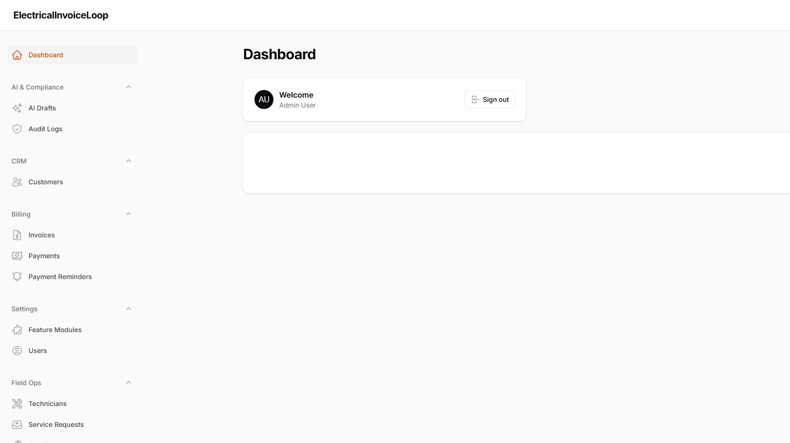
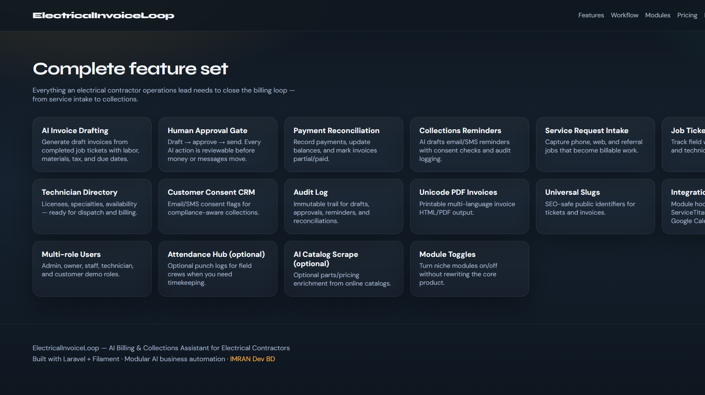
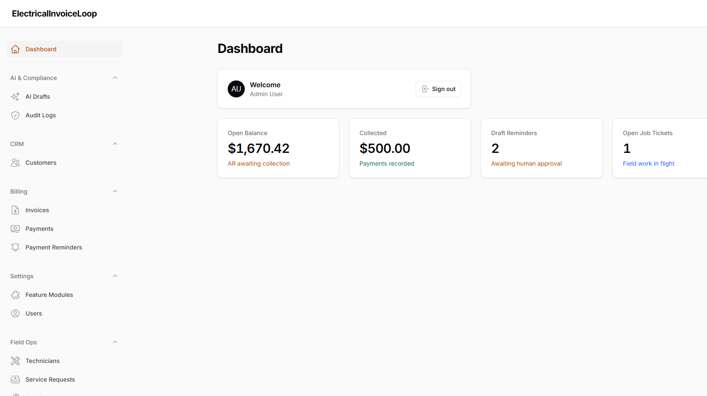
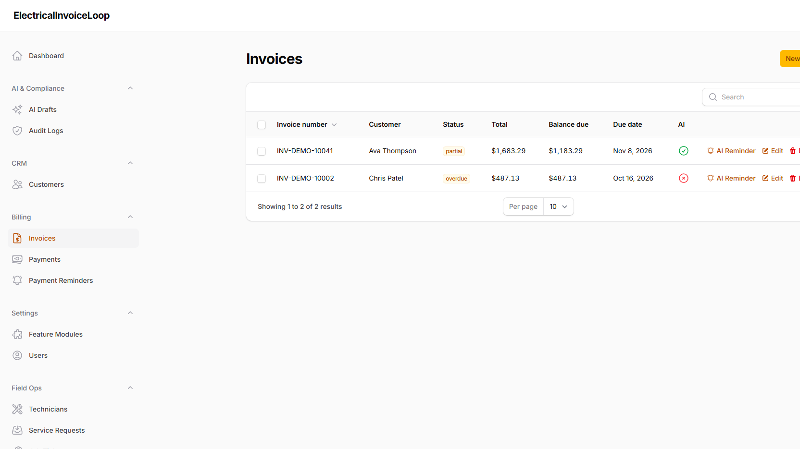

# ElectricalInvoiceLoop — AI Billing & Collections Assistant for Electrical Contractors (Laravel Filament SaaS)

**ElectricalInvoiceLoop** is a complete AI-powered **billing and collections automation** product for **electrical contractors**, built with **Laravel** and **Filament**. It drafts invoices from job tickets, reconciles payment status, sends **human-approved** reminders, and operates on service requests, field technicians, and job tickets — with modular features you can turn ON or OFF.

## SEO Title
ElectricalInvoiceLoop | AI Invoice Drafting, Payment Reconciliation & Collections Reminders for Electrical Contractors | Laravel Filament Business Automation

## What it solves
For electrical contractors: create draft invoices, reconcile payment status and send approved reminders; operate on service requests, field technicians and job tickets.

- **Target buyer:** Electrical Contractors owner / operations lead
- **Sector:** Home & Field Services
- **Function:** Finance
- **Workflow:** Billing & Collections Assistant
- **MVP:** 1 intake trigger → draft/action → human approval → audit log
- **Pilot pricing:** $199–$799/mo
- **Integrations ready:** Jobber / ServiceTitan / QuickBooks / Google Calendar
- **Risk/compliance:** MED — messaging consent, licensing and safety

## Screenshots





## Local URL
- Public site: http://localhost:8101
- Admin panel: http://localhost:8101/admin

## Quick start (Docker)
```bash
cd pipeline/apps/ElectricalInvoiceLoop
docker compose up -d --build
```
Wait for MySQL healthy, then open http://localhost:8101

## Demo users
Password for all accounts: `password`

| Role | Email |
|------|-------|
| Admin | admin@electricalinvoiceloop.test |
| Owner | owner@electricalinvoiceloop.test |
| Staff | staff@electricalinvoiceloop.test |
| Technician | tech@electricalinvoiceloop.test |
| Customer | customer@electricalinvoiceloop.test |

## Feature modules (ON/OFF)
Toggle in **Admin → Feature Modules** or `config/modules.php` / env flags.

**Core ON by default**
- AI Invoice Drafting
- Collections & Reminders
- Payment Reconciliation
- Service Requests
- Job Tickets
- Field Technicians
- Customer Directory
- AI Draft Assistant
- Approval Audit Log

**Optional / niche (OFF or soft-on)**
- Unicode PDF Invoices
- Universal Slugs
- Technician Attendance Hub (OFF)
- AI Parts Catalog Scrape (OFF)
- Integrations Hub (OFF)
- Google Calendar Sync (OFF)
- QuickBooks Sync (OFF)

## Core automation workflow
1. Intake service request / completed job ticket
2. AI drafts invoice (labor hours × rate + materials + tax)
3. Owner/staff **approves** invoice
4. AI drafts payment reminder (consent-aware)
5. Human **approves & sends** reminder
6. Record payments → auto-reconcile balance
7. Every step written to **audit log**

## Public pages
- `/` Home — brand + value proposition
- `/features` Full feature catalog
- `/workflow` MVP automation loop
- `/modules` Live module ON/OFF board
- `/pricing` Pilot pricing
- `/demo` Demo credentials
- `/admin` Filament admin

## Tech stack
- PHP 8.3 · Laravel 13 · Filament 4
- MySQL 8 · Redis 7
- Docker Compose (app port **8101**)
- Multi-role auth: admin, owner, staff, technician, customer
- Local equivalents for private Packagist packages (`imrandevbd/*`) when unavailable:
  - AI Hub → `App\Services\AiDraftService`
  - Unicode PDF → `App\Services\UnicodePdfService`
  - Universal Slug → `App\Services\SlugService`
  - Attendance / catalog / admin panel concepts implemented as modules + Filament resources

## Keyword tags
`electrical contractor software`, `electrical billing software`, `AI invoice drafting`, `collections assistant`, `payment reconciliation`, `job ticket billing`, `field technician management`, `service request intake`, `electrical contractor SaaS`, `home services finance automation`, `Laravel Filament admin`, `AI business automation`, `accounts receivable automation`, `payment reminder software`, `messaging consent collections`, `QuickBooks electrical`, `ServiceTitan alternative billing`, `Jobber invoice automation`, `Google Calendar field sync`, `modular SaaS modules`, `multi-role contractor CRM`, `EV charger install invoicing`, `panel upgrade billing`, `electrical contractor cashflow`, `human-in-the-loop AI`, `audit log approvals`, `Unicode PDF invoices`, `Docker Laravel SaaS`, `ElectricalInvoiceLoop`

## Contact / Hire
- Developer: Imran Ahmed (IMRAN Dev BD)
- Website: https://imrandev.bd/contact
- Email: me@imrandev.bd
- GitHub: https://github.com/imranbru99
